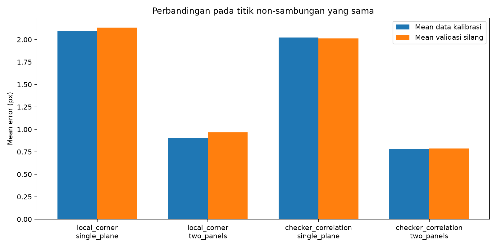

# Eksperimen metode pengurangan error

Seluruh 29 foto dipertahankan. Garis sudut di celah tengah dikecualikan secara seragam berdasarkan geometri fisik papan, bukan berdasarkan error. Dengan pengecualian ambigu terdahulu, tersisa 1216 titik non-sambungan yang sama pada semua varian.

| Detektor | Model | Pose | Mean latih (px) | RMS latih (px) | Mean validasi (px) | RMS validasi (px) |
|---|---|---:|---:|---:|---:|---:|
| local_corner | single_plane | 29 | 2.094790 | 2.449132 | 2.135134 | 2.519438 |
| local_corner | two_panels | 58 | 0.902377 | 1.276221 | 0.967958 | 1.431743 |
| checker_correlation | single_plane | 29 | 2.023705 | 2.338061 | 2.011729 | 2.338794 |
| checker_correlation | two_panels | 58 | 0.780340 | 1.048309 | 0.788276 | 1.056131 |

## Arti metode

- local_corner: pengukuran hasil audit sebelumnya.
- checker_correlation: mencocokkan pola empat kuadran terang/gelap pada citra, dengan puncak korelasi diinterpolasi subpiksel. Titik tidak disalin dari proyeksi kamera.
- single_plane: kedua sisi diasumsikan satu bidang datar dengan satu pose per foto.
- two_panels: tiap sisi papan lipat dianggap bidang tersendiri, dengan K/distorsi bersama dan dua pose per foto. 58 pose bukan 58 foto; jumlah foto tetap 29.

## Validasi dan batas kesimpulan

Validasi silang lima bagian menahan seluruh foto dari estimasi K/distorsi. Pada foto tertahan, pose hanya dihitung dari titik jangkar berselang-seling; error dihitung pada titik lain yang tidak dipakai untuk pose. Identitas 579 titik evaluasi sama di semua varian. Daftar foto training/tertahan serta indeks jangkar/evaluasi tersimpan di validation_plan.json; residual tiap titik ada di validation_errors.csv.

Model dua panel memiliki enam parameter pose tambahan per foto, sehingga penurunan error latih saja bukan bukti perbaikan. Hasil validasi silang memberi pemeriksaan tambahan, tetapi tetap berasal dari dataset yang sama dan metode dipilih setelah percobaan. Ini belum membuktikan akurasi pada data pengukuran independen.

Metode ini adalah pengembangan atas kalibrasi papan datar pada materi: tiap panel tetap diperlakukan sebagai target planar. Jangan menyajikannya sebagai prosedur identik dengan contoh satu papan. Baseline perkuliahan tetap tersedia dan tidak diganti otomatis.

Mean dan RMS harus dibaca terpisah. Mean di bawah 1 px belum berarti memenuhi acuan <0,5 px pada materi, terutama jika RMS masih sekitar atau di atas 1 px.

