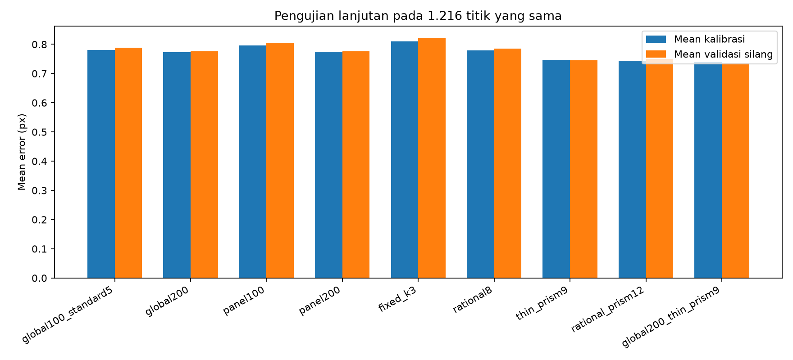

# Pengujian metode lanjutan

Semua varian memakai 29 foto, 1.216 titik non-sambungan dan 579 titik evaluasi validasi silang yang sama. Tidak ada titik dibuang berdasarkan residual.

| Eksperimen | Mean latih | RMS latih | Mean validasi | RMS validasi | Pemeriksaan pole |
|---|---:|---:|---:|---:|---|
| global100_standard5 | 0.780340 | 1.048309 | 0.788276 | 1.056131 | Tidak ditemukan pole positif pada area perkiraan |
| global200 | 0.773724 | 1.050670 | 0.775681 | 1.050442 | Tidak ditemukan pole positif pada area perkiraan |
| panel100 | 0.796137 | 1.069614 | 0.804733 | 1.078400 | Tidak ditemukan pole positif pada area perkiraan |
| panel200 | 0.774369 | 1.051776 | 0.775835 | 1.051546 | Tidak ditemukan pole positif pada area perkiraan |
| fixed_k3 | 0.810163 | 1.081102 | 0.821912 | 1.095552 | Tidak ditemukan pole positif pada area perkiraan |
| rational8 | 0.778886 | 1.046986 | 0.786049 | 1.054370 | Tidak ditemukan pole positif pada area perkiraan |
| thin_prism9 | 0.746152 | 0.995093 | 0.744839 | 1.001253 | Tidak ditemukan pole positif pada area perkiraan |
| rational_prism12 | 0.744029 | 0.992910 | 0.749371 | 1.012671 | Pole pada area radius sensor perkiraan |
| global200_thin_prism9 | 0.739131 | 0.996147 | 0.736410 | 0.996247 | Tidak ditemukan pole positif pada area perkiraan |

global200 menaikkan resolusi perataan menjadi 200 piksel/kotak tanpa mengubah luas template fisik. panel100/panel200 memakai inisialisasi homografi per panel. Model distorsi dibandingkan dengan titik citra yang sama: k3 dikunci nol, rational delapan koefisien, thin-prism tanpa rational (sembilan koefisien aktif), serta gabungan rational+prism (12 aktif). global200_thin_prism9 menggabungkan resolusi tinggi dengan model prism tanpa denominator rational.

Model rational mempunyai denominator 1+k4*r²+k5*r⁴+k6*r⁶. Akar positif menandakan titik singular. Radius sudut sensor dihitung secara perkiraan dari K; pemeriksaan ini bukan bukti lengkap invertibilitas, tetapi alasan untuk tidak merekomendasikan model yang mempunyai pole di area tersebut.

Pengguna mengonfirmasi kamera/zoom sama, fokus otomatis, dan pose kamera bervariasi. Variasi pose memang diperlukan. Perubahan intrinsik akibat autofocus mungkin terjadi pada sebagian kamera, tetapi pengaruhnya pada dataset ini belum diukur. Fokus terkunci diperlukan untuk pengambilan ulang yang lebih terkendali.

Pemilihan metode memakai validasi internal yang telah dipakai berkali-kali. Hasil bukan estimasi tak-bias pada data baru; seluruh percobaan, termasuk yang tidak membantu, harus dilaporkan.

