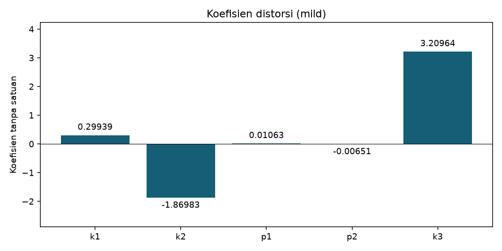
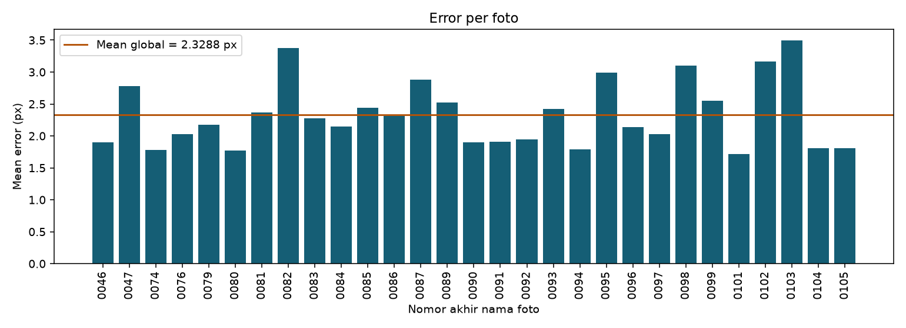

# Hasil kalibrasi kamera

Profil: **mild**. Ukuran kotak: **44 mm**. Foto dipakai: **29/29**. Titik dipakai: **1418**.

## Metode

Acuan: [materi Pertemuan 10](../../../references/Pertemuan_10.pdf), hlm. 45-54, 57-60 dan 65. Objek dimodelkan pada Z=0 dengan jarak antarsudut sesuai ukuran kotak. Kalibrasi menggunakan pasangan titik objek/citra dan cv2.calibrateCamera; projectPoints digunakan untuk menghitung error.

Pemrosesan tambahan membantu pengukuran sudut dan dijelaskan sebagai penyesuaian atas contoh materi. Inisialisasi dataset hanya dipakai bila hash foto cocok. Foto lain dideteksi melalui findChessboardCorners atau findChessboardCornersSB. Homografi hanya menentukan wilayah pencarian; koordinat akhir berasal dari respons sudut citra, dikembalikan ke piksel foto asli, dan diperhalus subpiksel. Tidak ada titik digeser ke proyeksi model atau dibuang menggunakan ambang error kalibrasi.

Profil baseline memakai tahap pengukuran hasil audit sebelumnya. Profil mild menambahkan Gaussian 3x3 (sigma 0,8) dan CLAHE (clipLimit 1,5; grid 8x8) untuk pencarian. Refinement akhir memakai intensitas tanpa CLAHE. Keduanya tetap memakai koordinat dan ukuran foto asli.

## Matriks intrinsik K (piksel)

```text
[  3107.004457      0.000000   1529.725199]
[     0.000000   3109.288036   2151.893889]
[     0.000000      0.000000      1.000000]
```

## Koefisien distorsi

| Koefisien | Nilai |
|---|---:|
| k1 | 0.299393625 |
| k2 | -1.869827500 |
| p1 | 0.010625367 |
| p2 | -0.006508538 |
| k3 | 3.209639085 |



## Error reproyeksi

- Mean: **2.328840 piksel**.
- RMS: **2.905960 piksel**.

Mean = rata-rata jarak Euclidean pengamatan terhadap proyeksi. RMS = akar rata-rata kuadrat jarak tersebut. Nilai balik calibrateCamera adalah RMS; keduanya dilaporkan terpisah karena istilah pada contoh materi hlm. 59-60 tidak konsisten.



| Foto | Titik | Mean (px) | RMS (px) |
|---|---:|---:|---:|
| IMG-20261026-WA0046.jpg | 49 | 1.8971 | 2.2299 |
| IMG-20261026-WA0047.jpg | 49 | 2.7814 | 3.8886 |
| IMG-20261026-WA0074.jpg | 49 | 1.7787 | 2.3219 |
| IMG-20261026-WA0076.jpg | 49 | 2.0291 | 2.7846 |
| IMG-20261026-WA0079.jpg | 49 | 2.1752 | 2.4005 |
| IMG-20261026-WA0080.jpg | 49 | 1.7690 | 2.0550 |
| IMG-20261026-WA0081.jpg | 49 | 2.3715 | 2.7470 |
| IMG-20261026-WA0082.jpg | 49 | 3.3790 | 4.5138 |
| IMG-20261026-WA0083.jpg | 49 | 2.2772 | 2.6472 |
| IMG-20261026-WA0084.jpg | 49 | 2.1431 | 2.3750 |
| IMG-20261026-WA0085.jpg | 49 | 2.4417 | 2.7950 |
| IMG-20261026-WA0086.jpg | 49 | 2.3106 | 3.1028 |
| IMG-20261026-WA0087.jpg | 49 | 2.8840 | 4.0724 |
| IMG-20261026-WA0089.jpg | 48 | 2.5208 | 2.9491 |
| IMG-20261026-WA0090.jpg | 49 | 1.8984 | 2.4085 |
| IMG-20261026-WA0091.jpg | 49 | 1.9096 | 2.1993 |
| IMG-20261026-WA0092.jpg | 49 | 1.9459 | 2.2398 |
| IMG-20261026-WA0093.jpg | 49 | 2.4188 | 2.7358 |
| IMG-20261026-WA0094.jpg | 48 | 1.7911 | 1.9945 |
| IMG-20261026-WA0095.jpg | 49 | 2.9955 | 3.3128 |
| IMG-20261026-WA0096.jpg | 49 | 2.1407 | 2.8991 |
| IMG-20261026-WA0097.jpg | 49 | 2.0236 | 2.4579 |
| IMG-20261026-WA0098.jpg | 49 | 3.1002 | 3.8402 |
| IMG-20261026-WA0099.jpg | 49 | 2.5467 | 3.1235 |
| IMG-20261026-WA0101.jpg | 48 | 1.7157 | 1.9889 |
| IMG-20261026-WA0102.jpg | 49 | 3.1630 | 3.5490 |
| IMG-20261026-WA0103.jpg | 49 | 3.4914 | 3.8850 |
| IMG-20261026-WA0104.jpg | 49 | 1.8104 | 2.1578 |
| IMG-20261026-WA0105.jpg | 49 | 1.8071 | 2.2047 |

## Pengamatan yang dikecualikan

- IMG-20261026-WA0089.jpg, baris 7 kolom 7: Pantulan kuat menutupi batas warna; penanda tertarik pada tekstur kayu dan posisi sudut tidak dapat ditetapkan dengan yakin.
- IMG-20261026-WA0094.jpg, baris 6 kolom 3: Pantulan dan tekstur mengaburkan pertemuan empat kotak; lokalisasi sudut tidak dapat dipastikan dari gambar.
- IMG-20261026-WA0101.jpg, baris 7 kolom 4: Penanda jatuh pada tekstur/pantulan di sisi celah papan; persilangan tunggal empat kotak tidak dapat ditetapkan dengan yakin dari gambar.

## Batas interpretasi

Materi hlm. 53 menggunakan acuan <0,25 px sangat bagus, <0,50 px dapat diterima dan >1 px perlu kalibrasi ulang. Ini acuan kuliah, bukan ambang universal untuk semua resolusi/kamera. Error lebih kecil pada data kalibrasi tidak membuktikan akurasi pada data baru. Sambungan, ketidakrataan papan, pantulan dan ketidakseragaman kotak tidak dapat diperbaiki secara fisik melalui CLAHE atau blur. Pengambilan ulang dengan papan datar-kaku dan konfigurasi kamera tetap masih diperlukan bila target akurasi belum tercapai.

Lingkungan: Python 3.14.8, OpenCV 5.0.0, NumPy 2.5.4.

Data lengkap: [./calibration.json](./calibration.json). parameters.npz menyimpan semua titik dan valid_mask; terapkan mask sebelum evaluasi ulang. Titik yang dikecualikan dilingkari oranye pada folder corners.
