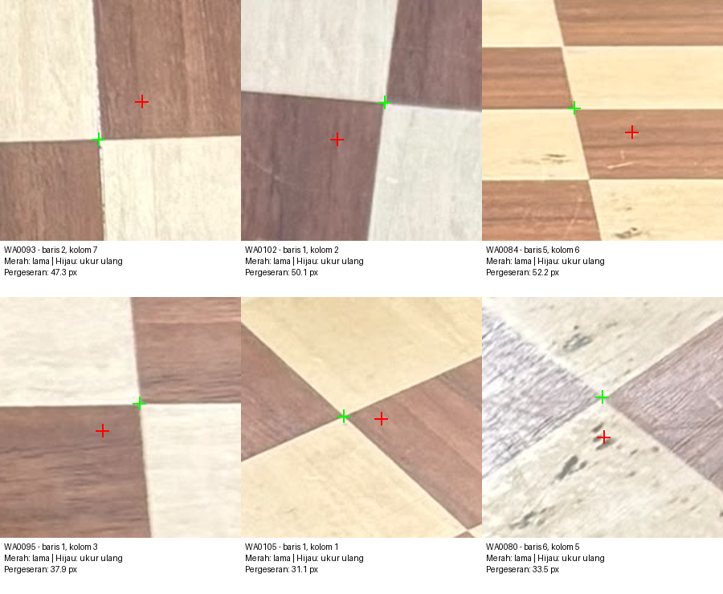
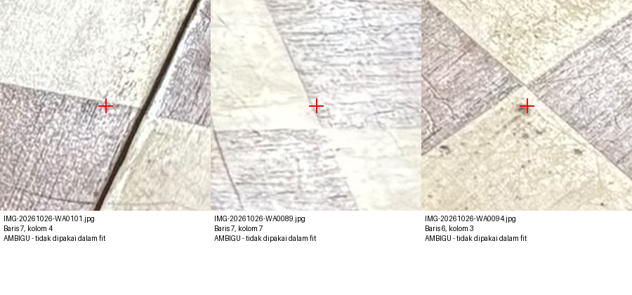
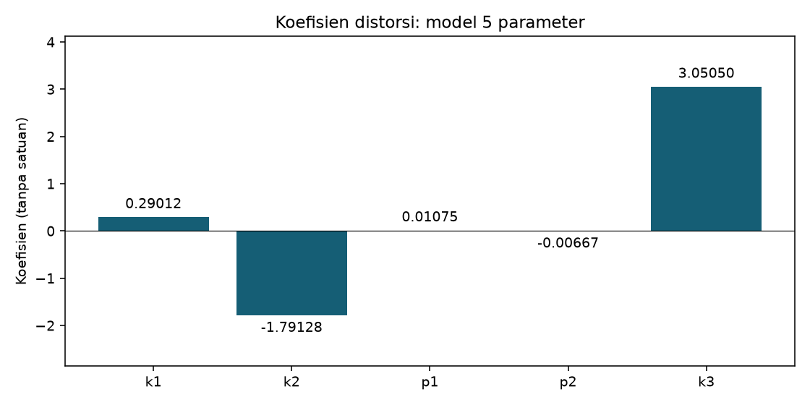
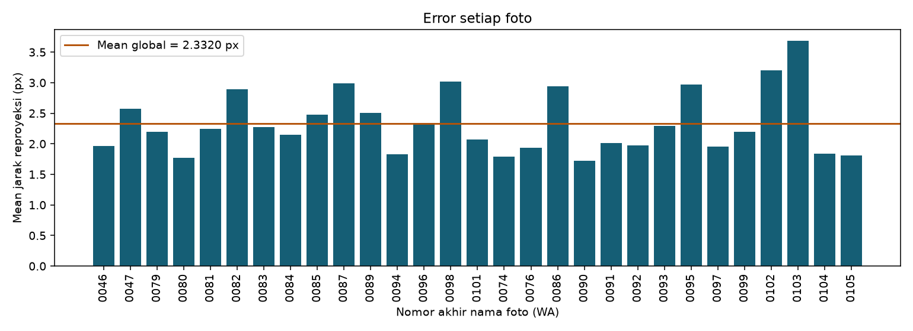

# Audit sudut dan hasil perhitungan ulang

## Temuan utama

Sebagian error tinggi berasal dari kesalahan lokalisasi sudut pada pemrosesan sebelumnya. Penanda ditemukan berada di dalam petak, pada tekstur kayu, atau pada pantulan. Ini adalah keterbatasan pengolahan sebelumnya; error tidak boleh seluruhnya dibebankan pada kualitas kamera atau papan.

Semua 1.421 titik pada 29 foto diukur ulang. Potongan gambar seluruh titik disusun menjadi 29 lembar detail dan delapan halaman tinjauan, kemudian ditinjau secara visual. Pemeriksaan ini menilai posisi penanda terhadap batas kotak, bukan pengukuran acuan independen dengan ketelitian subpiksel. Tiga titik tidak dapat ditetapkan dengan cukup yakin dari gambar dan tidak dimasukkan dalam estimasi akhir. Semua 29 foto dipertahankan; total titik yang dipakai 1.418.

71 titik bergeser lebih dari 10 piksel dari deteksi sebelumnya, dan 22 bergeser lebih dari 20 piksel. Pergeseran maksimum sekitar 52,23 piksel. Angka pergeseran bukan jumlah pasti titik yang terbukti salah; perubahan kecil maupun besar dapat mencakup ketidakpastian pengukuran. Contoh di bawah memperlihatkan kesalahan yang jelas secara visual.



Contoh konkret: WA0093 baris 2 kolom 7, WA0102 baris 1 kolom 2, dan WA0084 baris 5 kolom 6. Penanda lama berada di dalam kotak; penanda baru berada pada pertemuan batas kotak. Baris/kolom mengacu pada urutan kisi deteksi, sehingga orientasinya dapat berbeda antarfoto.

## Tiga titik ambigu

| Foto | Baris | Kolom | Alasan |
|---|---:|---:|---|
| IMG-20261026-WA0101.jpg | 7 | 4 | Penanda jatuh pada tekstur/pantulan di sisi celah papan; persilangan tunggal empat kotak tidak dapat ditetapkan dengan yakin dari gambar. |
| IMG-20261026-WA0089.jpg | 7 | 7 | Pantulan kuat menutupi batas warna; penanda tertarik pada tekstur kayu dan posisi sudut tidak dapat ditetapkan dengan yakin. |
| IMG-20261026-WA0094.jpg | 6 | 3 | Pantulan dan tekstur mengaburkan pertemuan empat kotak; lokalisasi sudut tidak dapat dipastikan dari gambar. |



Titik-titik tersebut tidak dipindahkan ke posisi proyeksi model. Tidak ada ambang error kalibrasi yang digunakan untuk membuang titik atau foto. Alasan pengecualian berasal dari citra yang ambigu; catatan ada di `titik_ambigu.json`.

## Metode perbaikan

1. Koordinat hasil percobaan 29 foto dipakai sebagai inisialisasi, bukan langsung dianggap benar.
2. Homografi robust memetakan perkiraan posisi kisi untuk menentukan wilayah pencarian. RANSAC pada tahap ini hanya menentukan inisialisasi; titik yang bukan inlier homografi tetap diukur ulang dan tetap dipakai jika tidak masuk daftar ambigu.
3. Sudut setiap petak diukur dari respons sudut citra setelah perataan perspektif, kemudian diperhalus secara subpiksel. Koordinat dikembalikan ke foto asli dan diperhalus dengan jendela kecil. Pergeseran refinement asli di atas 4 piksel tidak diterima; koordinat tetap berasal dari pengukuran sudut pada citra yang diratakan.
4. Kalibrasi K, distorsi, dan pose diestimasi ulang dari 1.418 titik. Mean dan RMS dihitung ulang melalui projectPoints dan diverifikasi terhadap RMS keluaran calibrateCamera.

Perhitungan memakai ukuran petak 42 mm dan gambar 3120 x 4160. Nilai 42 mm memakai interpretasi 4,2 cm dari ukuran yang diberikan pengguna.

## Perbandingan hasil

| Metrik | Sebelum audit, 29 foto | Setelah audit, 29 foto |
|---|---:|---:|
| Titik yang digunakan | 1421 | 1418 |
| Mean error (px) | 3.278054 | 2.332014 |
| RMS error (px) | 5.453131 | 2.900491 |

Penurunan mencakup pengukuran ulang titik dan pengecualian tiga titik ambigu, sehingga tidak boleh diatribusikan hanya pada salah satu perubahan. Sebagai pemeriksaan tambahan, setelah pengukuran ulang dengan semua 1.421 titik tetap dipakai, mean error 2,412655 px dan RMS 3,145625 px. Jadi, perbaikan terbesar sudah terlihat sebelum tiga titik ambigu dikeluarkan.

## Matriks intrinsik K, satuan piksel

```text
[   3099.817292       0.000000    1528.951496]
[      0.000000    3103.710639    2162.316966]
[      0.000000       0.000000       1.000000]
```

## Koefisien distorsi

| Koefisien | Nilai |
|---|---:|
| k1 | 0.29011626 |
| k2 | -1.79128262 |
| p1 | 0.01075087 |
| p2 | -0.00667268 |
| k3 | 3.05050038 |





## Hasil per foto

| Foto | Titik dipakai | Mean (px) | RMS (px) | Maksimum (px) |
|---|---:|---:|---:|---:|
| IMG-20261026-WA0046.jpg | 49 | 1.9674 | 2.2947 | 5.3556 |
| IMG-20261026-WA0047.jpg | 49 | 2.5782 | 3.4987 | 10.9188 |
| IMG-20261026-WA0074.jpg | 49 | 1.7886 | 2.3354 | 10.1305 |
| IMG-20261026-WA0076.jpg | 49 | 1.9374 | 2.5788 | 9.3458 |
| IMG-20261026-WA0079.jpg | 49 | 2.1927 | 2.4233 | 4.8223 |
| IMG-20261026-WA0080.jpg | 49 | 1.7732 | 2.0719 | 4.6352 |
| IMG-20261026-WA0081.jpg | 49 | 2.2484 | 2.5851 | 7.0461 |
| IMG-20261026-WA0082.jpg | 49 | 2.8879 | 3.4063 | 10.4327 |
| IMG-20261026-WA0083.jpg | 49 | 2.2720 | 2.6482 | 6.0824 |
| IMG-20261026-WA0084.jpg | 49 | 2.1517 | 2.3836 | 4.2751 |
| IMG-20261026-WA0085.jpg | 49 | 2.4730 | 2.8428 | 9.0956 |
| IMG-20261026-WA0086.jpg | 49 | 2.9370 | 4.1540 | 13.3534 |
| IMG-20261026-WA0087.jpg | 49 | 2.9886 | 4.0806 | 13.7175 |
| IMG-20261026-WA0089.jpg | 48 | 2.5049 | 2.9585 | 9.4500 |
| IMG-20261026-WA0090.jpg | 49 | 1.7218 | 1.9591 | 4.9070 |
| IMG-20261026-WA0091.jpg | 49 | 2.0137 | 2.4563 | 8.6934 |
| IMG-20261026-WA0092.jpg | 49 | 1.9710 | 2.2547 | 4.8366 |
| IMG-20261026-WA0093.jpg | 49 | 2.2959 | 2.6006 | 7.0623 |
| IMG-20261026-WA0094.jpg | 48 | 1.8258 | 2.0300 | 4.4060 |
| IMG-20261026-WA0095.jpg | 49 | 2.9660 | 3.3036 | 6.9807 |
| IMG-20261026-WA0096.jpg | 49 | 2.3463 | 3.2461 | 9.3175 |
| IMG-20261026-WA0097.jpg | 49 | 1.9541 | 2.3658 | 7.3896 |
| IMG-20261026-WA0098.jpg | 49 | 3.0174 | 3.8124 | 13.9357 |
| IMG-20261026-WA0099.jpg | 49 | 2.1990 | 2.4543 | 5.0587 |
| IMG-20261026-WA0101.jpg | 48 | 2.0691 | 3.0433 | 15.7801 |
| IMG-20261026-WA0102.jpg | 49 | 3.1973 | 3.5872 | 8.7795 |
| IMG-20261026-WA0103.jpg | 49 | 3.6814 | 4.1504 | 9.0905 |
| IMG-20261026-WA0104.jpg | 49 | 1.8434 | 2.1841 | 5.9935 |
| IMG-20261026-WA0105.jpg | 49 | 1.8129 | 2.2003 | 6.1569 |

## Batas hasil dan langkah berikutnya

Mean 2,332 piksel dan RMS 2,900 piksel masih tinggi untuk kalibrasi presisi. Audit visual tidak membuktikan seluruh posisi sudut akurat pada tingkat subpiksel. Sambungan papan terlihat sebagai celah, dan beberapa pertemuan kotak di kedua sisinya tidak membentuk persilangan tunggal yang ideal. Pantulan dan tekstur juga mengganggu lokalisasi. Ketidakrataan dan ketidakseragaman petak tetap dapat melanggar asumsi target datar seragam; kontribusi masing-masing faktor belum dapat dipisahkan secara pasti dengan data ini.

Tinjauan sambungan berdasarkan orientasi yang terlihat pada lembar potongan memberi mean residual sekitar 3,542 px pada titik sambungan, dibanding sekitar 2,131 px di luar sambungan. Ini merupakan indikasi lokasi masalah, bukan bukti bahwa sambungan adalah satu-satunya penyebab error.

Hasil ini bisa dilaporkan sebagai hasil eksperimen dengan keterbatasan yang jelas. Untuk mengejar akurasi lebih tinggi, prioritaskan target pola datar dan kaku dengan petak seragam, pencahayaan tanpa pantulan, serta kamera, lensa, fokus dan zoom yang konsisten. Hasil saat ini belum merupakan validasi pada foto pengujian independen.

## Menjalankan hasil terbaru

Dari folder Project, dengan lingkungan Python yang sudah terpasang:

```bash
source .venv/bin/activate
python kalibrasi_audit.py
```

Skrip membutuhkan `deteksi_audit.py`, `titik_ambigu.json`, foto asli dalam kedua subfolder Photo, dan `hasil_semua_foto/parameter_kalibrasi.npz` sebagai sumber inisialisasi. Hasil terbaru berada di `hasil_audit`. Versi 14 foto dan versi 29 foto sebelum audit tetap tersedia untuk perbandingan.

`hasil_audit/parameter_kalibrasi.npz` menyimpan semua 49 pengamatan per foto di image_points/object_points, beserta valid_mask untuk menentukan titik yang dipakai kalibrasi. Saat memakai kembali parameter tersebut, selalu terapkan valid_mask. Pose berupa rvecs dan tvecs; translasi bersatuan mm.

## Bukti audit

- `audit_sudut/perubahan_dan_residual.csv`: koordinat sebelum/sesudah, perpindahan, residual, dan status dipakai setiap titik.
- `audit_sudut/ringkasan_audit.json`: jumlah titik dan ringkasan audit.
- `audit_sudut/semua_titik_*.png`: potongan seluruh 49 titik untuk masing-masing dari 29 foto; tanda merah menunjukkan posisi pengukuran, termasuk titik ambigu yang akhirnya tidak dipakai.
- `audit_sudut/audit_seluruh_foto_1.jpg` sampai `audit_seluruh_foto_8.jpg`: halaman tinjauan semua foto.
- `hasil_audit/deteksi/`: penanda di foto lengkap; lingkaran oranye menandai titik ambigu.
- `hasil_audit/audit/`: rincian respons sudut dan refinement tiap foto.
