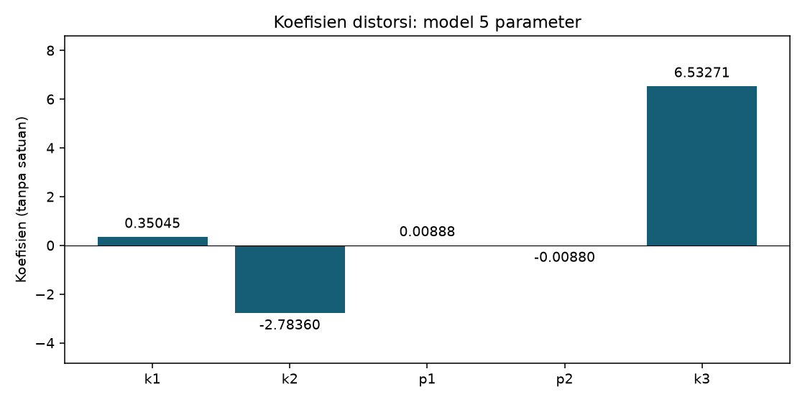
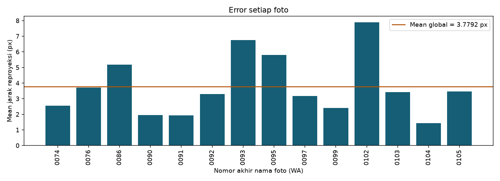
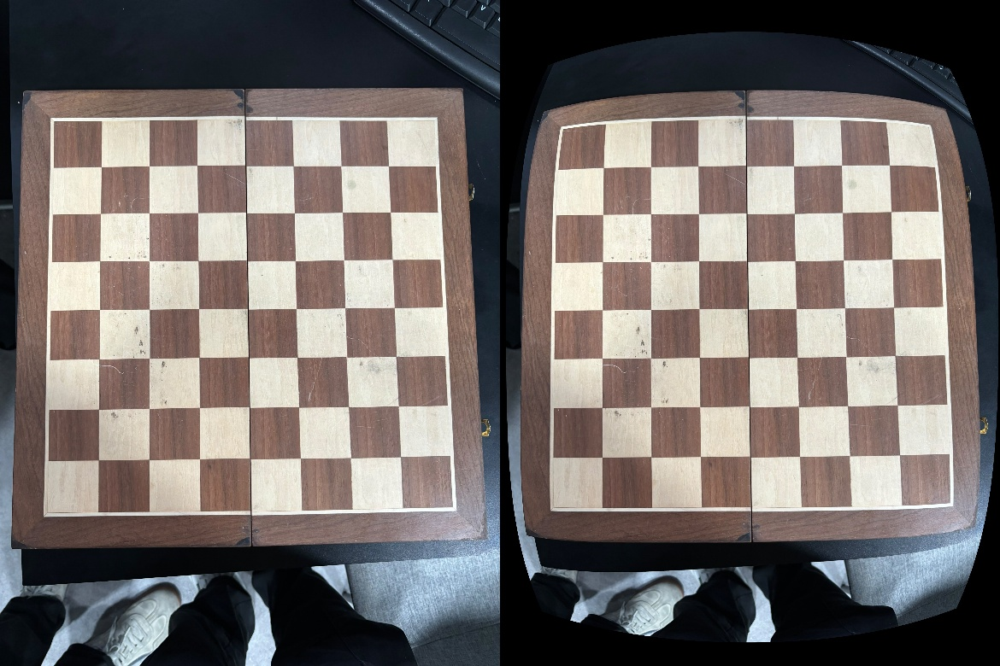

# Laporan hasil kalibrasi kamera

Catatan: ini hasil percobaan sebelumnya. Hasil terbaru dan temuan koreksi deteksi tersedia di Laporan_Audit_Kalibrasi.md.

Tugas Praktikum Mandiri - Instrumentasi Sistem Visual, Pertemuan 10

## Data dan metode

Terdapat 29 foto, semuanya berukuran 3120 x 4160 piksel. Papan memiliki 8 x 8 kotak dengan 7 x 7 sudut dalam. Deteksi lengkap berhasil pada 14 foto; 15 foto lainnya tidak digunakan karena pola lengkap tidak ditemukan otomatis. Jumlah titik yang digunakan adalah 14 x 49 = 686 titik.

Koordinat objek didefinisikan sebagai (X,Y,0), dengan jarak antarsudut 42 mm. Pengguna memberikan ukuran 4,2 x 4,2, yang ditafsirkan sebagai cm. Ukuran bidang berpola 8 x 8 kotak adalah 336 x 336 mm (tanpa bingkai); bentang sudut dalam adalah 252 x 252 mm. Deteksi awal menggunakan findChessboardCornersSB atau findChessboardCorners pada gambar diperkecil, dengan penghalusan bila diperlukan. Koordinat dikembalikan ke resolusi asli dan diperhalus menggunakan cornerSubPix. Kalibrasi dijalankan dengan calibrateCamera OpenCV 4.11.0, model pinhole, skew nol, dan lima koefisien distorsi [k1,k2,p1,p2,k3]. Semua foto yang berhasil terdeteksi digunakan tanpa seleksi berdasarkan error.

## Matriks intrinsik K

Satuan fx, fy, cx, dan cy adalah piksel, untuk gambar 3120 x 4160.

```text
[   3094.057717        0.000000     1513.955159]
[      0.000000     3102.573183     2169.240974]
[      0.000000        0.000000        1.000000]
```

K = [[fx,0,cx],[0,fy,cy],[0,0,1]]. Panjang fokus fisik dalam mm tidak dapat dihitung tanpa ukuran sensor atau informasi lain yang memadai.

## Koefisien distorsi

| Parameter | Nilai |
|---|---:|
| k1 | 0.35044796 |
| k2 | -2.78360306 |
| p1 | 0.00887873 |
| p2 | -0.00880486 |
| k3 | 6.53271152 |



Koefisien radial k1,k2,k3 bekerja bersama melalui faktor 1+k1*r^2+k2*r^4+k3*r^6; p1,p2 adalah koefisien tangensial, dengan r berupa radius pada koordinat kamera ternormalisasi. Tinggi batang antarparameter tidak langsung menyatakan besar perpindahan piksel. Koefisien orde tinggi yang besar perlu ditafsirkan hati-hati; nilai ini tidak membuktikan sifat fisik lensa secara terpisah dari ketidaksempurnaan target dan data.

## Mean Reprojection Error

Untuk setiap titik, e_ij = ||p_ij - proyeksi(K,D,R_i,t_i,P_j)||_2.

Mean = sum(e_ij) / 686.
RMS = sqrt(sum(e_ij^2) / 686).

- **Mean Reprojection Error = 3.779167 piksel.**
- **RMS Reprojection Error = 6.354952 piksel.**

Nilai ret dari calibrateCamera adalah RMS; karena tugas meminta mean, rata-rata jarak Euclidean dihitung terpisah menggunakan projectPoints. RMS hasil perhitungan ulang cocok dengan keluaran OpenCV dengan selisih kurang dari 0,00001 piksel.



| Foto | Mean (px) | RMS (px) | Maksimum (px) |
|---|---:|---:|---:|
| IMG-20261026-WA0074.jpg | 2.5530 | 3.5582 | 15.7539 |
| IMG-20261026-WA0076.jpg | 3.7017 | 4.9423 | 16.1859 |
| IMG-20261026-WA0086.jpg | 5.1881 | 8.0570 | 25.5782 |
| IMG-20261026-WA0090.jpg | 1.9425 | 2.4115 | 9.4844 |
| IMG-20261026-WA0091.jpg | 1.9223 | 2.1731 | 4.2639 |
| IMG-20261026-WA0092.jpg | 3.2910 | 4.1023 | 10.3709 |
| IMG-20261026-WA0093.jpg | 6.7471 | 12.4270 | 44.9629 |
| IMG-20261026-WA0095.jpg | 5.7915 | 8.3370 | 32.8258 |
| IMG-20261026-WA0097.jpg | 3.1700 | 4.7806 | 17.0271 |
| IMG-20261026-WA0099.jpg | 2.4138 | 2.7496 | 6.3551 |
| IMG-20261026-WA0102.jpg | 7.8823 | 11.4273 | 44.2718 |
| IMG-20261026-WA0103.jpg | 3.4094 | 3.9552 | 9.3866 |
| IMG-20261026-WA0104.jpg | 1.4403 | 1.7002 | 3.7109 |
| IMG-20261026-WA0105.jpg | 3.4552 | 5.7060 | 29.3627 |

## Pembahasan dan kesimpulan

Jumlah foto terdeteksi memenuhi minimum 12 foto pada tugas. Namun, hasil numerik menunjukkan kecocokan model masih rendah: mean error 3,779 piksel dan RMS 6,355 piksel. Hasil ini tidak layak disebut kalibrasi presisi. Materi kuliah halaman 53 menandai error di atas 1 piksel sebagai buruk; penilaian ambang tersebut berasal dari materi kuliah, bukan standar universal untuk semua kamera dan resolusi.

Papan berupa papan catur lipat dengan sambungan di tengah. Sambungan dan kemungkinan ketidakrataan atau ketidakseragaman ukuran kotak melanggar asumsi target bidang datar dengan titik yang berjarak seragam. Ini merupakan kemungkinan kontribusi error, bukan penyebab tunggal yang telah dibuktikan. Lokalisasi sudut, perubahan fokus/zoom, atau perbedaan sumber kamera juga belum dapat disingkirkan. Kesamaan resolusi tidak membuktikan kesamaan kamera.

Pembaruan ukuran petak menjadi 42 mm dilakukan dengan mengalikan koordinat objek dan translasi hasil sebelumnya dengan 42. Proyeksi tidak berubah karena skala seragam tersebut saling menghilangkan dalam pembagian perspektif. K, koefisien distorsi, dan error piksel tetap sama. Ukuran petak yang baru diberikan tidak mengatasi tingginya error intrinsik. Sebaliknya, petak yang tidak seragam atau papan yang tidak datar dapat memengaruhi hasil.

Prioritas perbaikan adalah menggunakan pola kalibrasi tercetak yang datar dan kaku, mengunci kamera/lensa/zoom/fokus serta resolusi, kemudian mengambil sedikitnya 12 foto tajam dengan variasi kemiringan dan posisi termasuk dekat tepi gambar. Simpan berkas asli dari kamera. Setelah itu jalankan ulang kalibrasi dan evaluasi pada foto tambahan yang tidak dipakai mengestimasi parameter. Menambah jumlah foto saja tidak menjamin error turun jika kualitas target tetap bermasalah.

## Contoh koreksi

Kiri: foto asli. Kanan: undistort dengan K dan D hasil estimasi, menggunakan K yang sama sebagai matriks output. Contoh ini memperlihatkan operasi koreksi, bukan bukti peningkatan akurasi. Karena kualitas kalibrasi rendah, hasil koreksi perlu dianggap sementara.



## Berkas pendukung

Skrip: kalibrasi.py. Parameter lengkap dan titik pengamatan: hasil/parameter_kalibrasi.npz. Angka hasil: hasil/hasil_kalibrasi.json. Status foto: hasil/deteksi.csv. Bukti deteksi: hasil/deteksi/. Petunjuk menjalankan: README.md.

## Rujukan

1. Yakub Fahim Luckyarno. Optika Geometri Kamera & Kalibrasi Sensorik, 25 Oktober 2026, halaman 53, 57-60, dan 65. Materi PDF yang diberikan pengguna.
2. [OpenCV - Camera Calibration](https://docs.opencv.org/4.x/dc/dbb/tutorial_py_calibration.html), dokumentasi resmi metode kalibrasi dan evaluasi reproyeksi.
