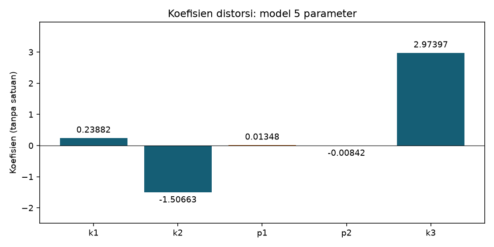
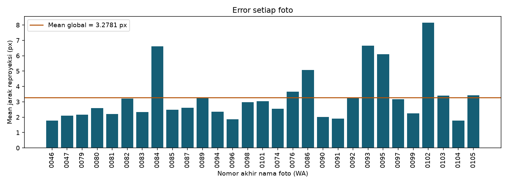

# Kalibrasi menggunakan seluruh 29 foto

Catatan: ini hasil percobaan sebelumnya. Hasil terbaru dan temuan koreksi deteksi tersedia di Laporan_Audit_Kalibrasi.md.

Ukuran gambar: 3120 x 4160 piksel. Papan: 8 x 8 kotak, 7 x 7 sudut dalam. Sisi kotak: 42 mm, berdasarkan interpretasi ukuran 4,2 cm yang diberikan pengguna. Total titik pengamatan: 29 x 49 = 1421 titik.

## Metode

14 foto memakai koordinat deteksi hasil percobaan sebelumnya. Pada 15 foto lainnya, batas empat pojok bidang berpola ditentukan secara visual dan disimpan sebagai koordinat ternormalisasi di `batas_papan.json`. Batas ini digunakan untuk meratakan perspektif dan membatasi wilayah pencarian setiap sudut. Posisi sudut diukur dari respons sudut citra, diperhalus, dikembalikan ke foto asli, lalu diperhalus kembali dengan cornerSubPix. Posisi 49 titik bukan sekadar grid proyeksi dari empat pojok. Ini adalah deteksi dengan bantuan penentuan batas papan, bukan keberhasilan deteksi pola sepenuhnya otomatis.

Semua 29 foto dimasukkan dalam kalibrasi tanpa menghapus foto atau titik berdasarkan besar error. Model menggunakan lima koefisien [k1,k2,p1,p2,k3]. Hasil 14 foto disimpan terpisah di folder `hasil`; hasil 29 foto berada di `hasil_semua_foto`.

## Hasil dan perbandingan

| Percobaan | Jumlah foto | Mean error (px) | RMS error (px) |
|---|---:|---:|---:|
| Deteksi awal | 14 | 3.779167 | 6.354952 |
| Semua foto, dengan bantuan batas papan | 29 | 3.277764 | 5.452941 |

Mean adalah rata-rata jarak Euclidean antara titik pada foto dengan hasil proyeksi model. RMS adalah akar rata-rata kuadrat jarak tersebut. RMS dihitung ulang dari titik dan cocok dengan keluaran calibrateCamera dengan selisih kurang dari 0,0001 piksel.

Perbandingan ini melibatkan perubahan jumlah foto sekaligus metode deteksi, sehingga penurunan error tidak boleh dianggap bukti pengaruh jumlah foto saja. Angka mean sekitar 3,278 piksel dan RMS sekitar 5,453 piksel masih besar. Hasil ini belum layak disebut kalibrasi presisi. Penentuan batas secara visual, sudut pandang sangat landai, pantulan, sambungan papan dan ketidakrataan target dapat memengaruhi posisi titik. Respons sudut lokal yang positif juga tidak menjamin semua posisi tepat; bukti penandaan tetap perlu ditinjau.

## Matriks intrinsik K (piksel)

```text
[   3083.248431       0.000000    1519.753185]
[      0.000000    3093.864745    2211.466852]
[      0.000000       0.000000       1.000000]
```

## Koefisien distorsi

| Koefisien | Nilai |
|---|---:|
| k1 | 0.23882888 |
| k2 | -1.50646918 |
| p1 | 0.01348032 |
| p2 | -0.00841495 |
| k3 | 2.97319494 |





## Detail per foto

| Foto | Mean (px) | RMS (px) | Maksimum (px) |
|---|---:|---:|---:|
| IMG-20261026-WA0046.jpg | 1.7854 | 2.0847 | 5.9611 |
| IMG-20261026-WA0047.jpg | 2.0926 | 2.6604 | 10.9798 |
| IMG-20261026-WA0074.jpg | 2.5507 | 3.5409 | 15.9020 |
| IMG-20261026-WA0076.jpg | 3.6518 | 4.9560 | 16.2014 |
| IMG-20261026-WA0079.jpg | 2.1622 | 2.3665 | 4.9128 |
| IMG-20261026-WA0080.jpg | 2.5931 | 5.1560 | 32.4405 |
| IMG-20261026-WA0081.jpg | 2.2150 | 2.4609 | 4.3522 |
| IMG-20261026-WA0082.jpg | 3.2214 | 4.7040 | 25.1456 |
| IMG-20261026-WA0083.jpg | 2.3417 | 2.7000 | 5.2761 |
| IMG-20261026-WA0084.jpg | 6.6145 | 9.7808 | 46.5146 |
| IMG-20261026-WA0085.jpg | 2.4786 | 2.8453 | 9.0026 |
| IMG-20261026-WA0086.jpg | 5.0735 | 8.0386 | 25.7478 |
| IMG-20261026-WA0087.jpg | 2.6191 | 3.1837 | 12.1596 |
| IMG-20261026-WA0089.jpg | 3.2985 | 4.7078 | 22.9025 |
| IMG-20261026-WA0090.jpg | 2.0140 | 2.6272 | 11.5515 |
| IMG-20261026-WA0091.jpg | 1.9070 | 2.1331 | 4.1587 |
| IMG-20261026-WA0092.jpg | 3.2604 | 4.0764 | 10.4219 |
| IMG-20261026-WA0093.jpg | 6.6622 | 12.3836 | 44.9928 |
| IMG-20261026-WA0094.jpg | 2.3574 | 3.6341 | 19.8293 |
| IMG-20261026-WA0095.jpg | 6.0952 | 8.4270 | 31.9806 |
| IMG-20261026-WA0096.jpg | 1.8680 | 2.1064 | 3.9179 |
| IMG-20261026-WA0097.jpg | 3.1639 | 4.8471 | 16.8671 |
| IMG-20261026-WA0098.jpg | 2.9754 | 4.4246 | 23.9682 |
| IMG-20261026-WA0099.jpg | 2.2540 | 2.5780 | 6.4944 |
| IMG-20261026-WA0101.jpg | 3.0487 | 6.2430 | 39.8339 |
| IMG-20261026-WA0102.jpg | 8.1410 | 11.5951 | 43.7336 |
| IMG-20261026-WA0103.jpg | 3.3994 | 3.9391 | 9.4979 |
| IMG-20261026-WA0104.jpg | 1.7806 | 2.1609 | 5.7045 |
| IMG-20261026-WA0105.jpg | 3.4299 | 5.6599 | 29.2314 |

## Menjalankan ulang

Di terminal folder Project, setelah lingkungan Python dan requirements terpasang:

```bash
source .venv/bin/activate
python kalibrasi_semua_foto.py
```

Skrip membaca seluruh foto secara rekursif dari kedua subfolder Photo, memakai batas papan dari `batas_papan.json` dan koordinat deteksi awal dari `hasil/parameter_kalibrasi.npz`. Karena batas papan ditentukan untuk foto yang ada, skrip ini khusus dataset tersebut. Foto baru perlu batas papan baru atau deteksi lain.

Nama folder Dipakai dan Belum_Dipakai menunjukkan status percobaan awal 14 foto. Pada percobaan ini, keduanya dibaca dan semua foto dipakai. Lokasi foto tidak diubah lagi.

Bukti deteksi tiap foto: `hasil_semua_foto/deteksi`. Nilai lengkap: `hasil_semua_foto/hasil_kalibrasi.json`. Titik, pose, dan parameter: `hasil_semua_foto/parameter_kalibrasi.npz`. Error per foto: `hasil_semua_foto/error_per_foto.csv`.
