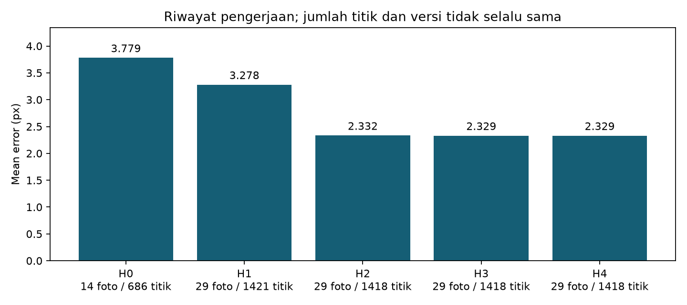
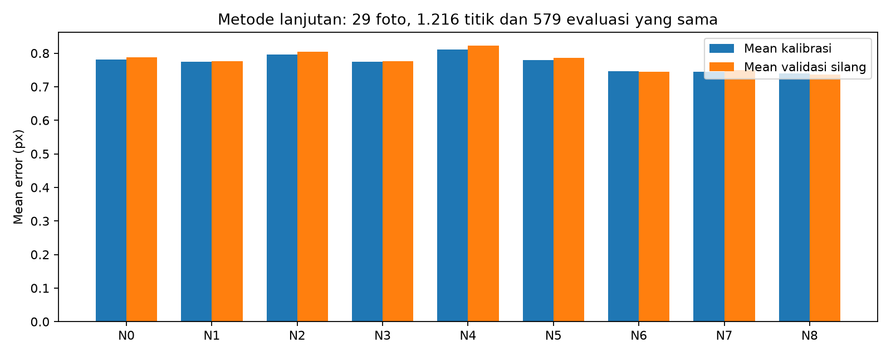
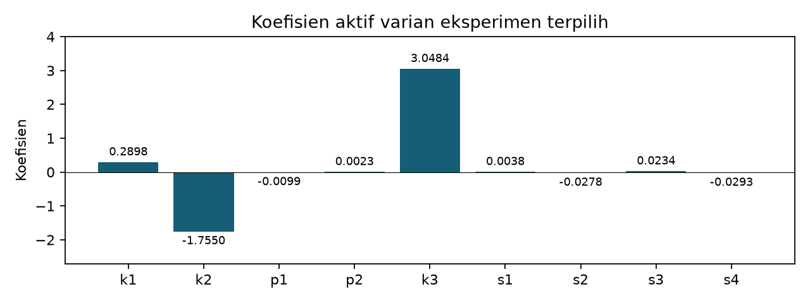

# Perkembangan Metode Kalibrasi Kamera

Tugas Mandiri Instrumentasi Sistem Visual | Pertemuan 10

## 1. Tujuan, data, dan batas perbandingan

Laporan ini mendokumentasikan perubahan metode beserta dampaknya terhadap error. Riwayat yang jumlah titik/versinya berubah dipisahkan dari eksperimen terkontrol yang memakai identitas titik sama. Hasil yang tidak membantu dan hasil numerik yang bermasalah tetap dicatat.

| Aspek | Keterangan |
|---|---|
| Foto | 29 foto asli; 3120 x 4160 piksel |
| Pola dan ukuran | 8 x 8 kotak; 7 x 7 sudut dalam; sisi 44 mm sesuai konfigurasi |
| Akuisisi terkonfirmasi | Kamera dan zoom sama; fokus otomatis; posisi/orientasi kamera berubah |
| Metode dasar | Target planar Z=0, refinement sudut dan cv2.calibrateCamera sesuai materi hlm. 45-54, 57-60 |
| Perluasan | Pengukuran berbasis citra, model dua panel, resolusi perataan, dan model distorsi tambahan |

## 2. Definisi metrik

Untuk tiap titik yang dipakai, e = ||p_terukur - p_proyeksi||. Mean = jumlah(e)/M dan RMS = akar[jumlah(e^2)/M], dalam piksel. Nilai balik calibrateCamera adalah RMS; mean dihitung terpisah melalui projectPoints. Contoh cetak hlm. 59 menyebut mean, sedangkan hlm. 60 menjelaskan RMS; laporan ini mempertahankan keduanya.

Perubahan posisi kamera memang diperlukan untuk menyediakan pose beragam. Fokus otomatis merupakan kemungkinan sumber variasi intrinsik pada sebagian kamera; pengaruhnya pada dataset ini belum diukur. Pengembangan model tetap mengasumsikan satu K/distorsi bersama, sehingga kontrol fokus penting untuk pengambilan ulang.

## 3. Hasil metode dasar saat ini (H3)

29 foto, 1.418 titik: mean 2.328715 px dan RMS 2.883255 px. Tiga pengamatan ambigu dikecualikan berdasarkan citra: WA0101 (baris 7 kolom 4), WA0089 (7,7), dan WA0094 (6,3). Semua foto tetap dipakai.

K dasar: fx=3101.13515, fy=3104.63410, cx=1528.36327, cy=2161.05458 piksel; skew=0 dan K33=1. D dasar [k1,k2,p1,p2,k3] = 0.292032, -1.800879, 0.010743, -0.006656, 3.054641.


---

## 4. Riwayat pengerjaan: perubahan data dan deteksi

| Tahap | Foto | Titik | Mean px | RMS px | OpenCV |
|---|---|---|---|---|---|
| H0 | 14 | 686 | 3.7792 | 6.3550 | 4.11.0 |
| H1 | 29 | 1421 | 3.2781 | 5.4531 | 5.0.0 |
| H2 | 29 | 1418 | 2.3320 | 2.9005 | 4.11.0 |
| H3 | 29 | 1418 | 2.3287 | 2.8833 | 5.0.0 |
| H4 | 29 | 1418 | 2.3288 | 2.9060 | 5.0.0 |

H0 - Deteksi awal, 14 foto: Deteksi pola lengkap berhasil pada 14 dari 29 foto.

H1 - Seluruh foto dengan bantuan batas papan: 29 foto berhasil dimasukkan memakai penyesuaian deteksi.

H2 - Audit dan pengukuran ulang sudut: Penanda yang salah diukur ulang; tiga titik ambigu dikecualikan berdasarkan citra.

H3 - Ukuran 44 mm dan lingkungan proyek saat ini: Ukuran kotak dikoreksi menjadi 44 mm; dijalankan ulang dengan OpenCV 5.

H4 - Tambahan Gaussian dan CLAHE: Gaussian 3x3 sigma 0,8 dan CLAHE untuk pencarian sudut.



H0-H2 tidak menggunakan kumpulan pengamatan yang sama. H2-H3 juga berbeda lingkungan OpenCV. Mengubah ukuran seragam dari 42 menjadi 44 mm hanya mengubah skala translasi; perubahan ukuran bukan penyebab turunnya error. Perbedaan kecil H2-H3 terkait lingkungan/pengolahan. H3-H4 memakai pengamatan yang sama dan menunjukkan Gaussian+CLAHE tidak membantu: RMS meningkat.

Snapshot angka, versi, ukuran, alasan perubahan, lokasi artefak lama, dan hash SHA-256 sumber tersedia pada reports/data/method_history.json. Artefak lama dipertahankan di arsip lokal; snapshot disertakan agar riwayat tetap terlihat setelah clone.


---

## 5. Eksperimen terkontrol: detektor dan bentuk papan

Garis sudut pada celah tengah dikecualikan secara seragam berdasarkan geometri, tanpa melihat residual: 203 titik sambungan (termasuk satu yang sudah ambigu), serta dua titik ambigu lain di luar sambungan. Tersisa 1.216 identitas titik yang sama pada seluruh varian. Jumlah foto tetap 29. CV berarti validasi silang.

| ID / detektor / model | Mean latih | RMS latih | Mean CV | RMS CV |
|---|---|---|---|---|
| C1: local_corner / single_plane | 2.0948 | 2.4491 | 2.1351 | 2.5194 |
| C2: local_corner / two_panels | 0.9024 | 1.2762 | 0.9680 | 1.4317 |
| C3: checker_correlation / single_plane | 2.0237 | 2.3381 | 2.0117 | 2.3388 |
| C4: checker_correlation / two_panels | 0.7803 | 1.0483 | 0.7883 | 1.0561 |


C1 -> C2 mengubah model menjadi dua panel: mean turun sekitar 2,095 -> 0,902 px. C2 -> C4 mengganti pengukuran sudut menjadi korelasi empat kuadran: sekitar 0,902 -> 0,780 px. C1 -> C3 menunjukkan korelasi saja memberi perbaikan jauh lebih kecil. Model dua panel merupakan perubahan dominan pada pengujian ini.

Dua panel berbagi K/distorsi, tetapi memiliki dua pose per foto: 58 pose dari 29 foto. Tambahan enam parameter pose per foto dapat menurunkan error latih; karena itu hasil juga dibandingkan melalui validasi silang. Ini pengembangan atas contoh satu papan datar dalam materi, dan tidak diganti namanya seolah prosedur identik.


---

## 6. Langkah lanjutan: resolusi dan model distorsi

| ID / perubahan | Mean latih | RMS latih | Mean CV | RMS CV | Screen |
|---|---|---|---|---|---|
| N0: global100_standard5 | 0.7803 | 1.0483 | 0.7883 | 1.0561 | Lolos* |
| N1: global200 | 0.7737 | 1.0507 | 0.7757 | 1.0504 | Lolos* |
| N2: panel100 | 0.7961 | 1.0696 | 0.8047 | 1.0784 | Lolos* |
| N3: panel200 | 0.7744 | 1.0518 | 0.7758 | 1.0515 | Lolos* |
| N4: fixed_k3 | 0.8102 | 1.0811 | 0.8219 | 1.0956 | Tolak |
| N5: rational8 | 0.7789 | 1.0470 | 0.7861 | 1.0544 | Lolos* |
| N6: thin_prism9 | 0.7462 | 0.9951 | 0.7448 | 1.0013 | Lolos* |
| N7: rational_prism12 | 0.7440 | 0.9929 | 0.7493 | 1.0126 | Tolak |
| N8: global200_thin_prism9 | 0.7391 | 0.9961 | 0.7364 | 0.9962 | Lolos* |



N1 menaikkan resolusi menjadi 200 piksel/kotak. N2-N3 memakai homografi awal per panel. N4 mengunci k3=0. N5 memakai rational delapan koefisien. N6 menambah empat suku thin-prism tanpa denominator rational (sembilan koefisien aktif). N7 menggabungkan rational dan prism (12 aktif). N8 menggabungkan resolusi 200 dengan thin-prism sembilan koefisien.

*Lolos berarti hanya lolos pemeriksaan numerik terbatas: tidak ditemukan pole denominator pada area radius sensor perkiraan dan tidak ada Jacobian nonpositif pada grid 31 x 31. Ini bukan bukti invertibilitas global atau akurasi di seluruh sensor. N4 menunjukkan pembalikan pada sebagian grid perkiraan; N7 mempunyai pole positif sekitar r=0,465 dan tidak direkomendasikan untuk seluruh gambar meski error latih turun.

Resolusi lebih tinggi memberi perbaikan kecil, sedangkan homografi per panel tidak menunjukkan keuntungan konsisten. Menambah koefisien rational saja hampir tidak membantu. Hasil negatif tersebut tetap disertakan agar keputusan tidak hanya didasarkan pada percobaan terbaik.


---

## 7. Varian eksperimen paling menjanjikan

Terpilih pada uji internal: global200_thin_prism9. Pemilihan berdasarkan RMS CV terendah di antara varian yang lolos screen numerik. Metode dasar tetap tersedia dan tidak diganti otomatis. Hasil: mean 0.739131 px; RMS 0.996147 px; mean CV 0.736412 px; RMS CV 0.996247 px.

```text
K eksperimen (piksel):
[  3073.67979      0.00000   1603.31091]
[     0.00000   3080.65734   2104.63981]
[     0.00000      0.00000      1.00000]
```

| Koefisien aktif | Nilai |
|---|---|
| k1 | 0.289787697 |
| k2 | -1.754977251 |
| p1 | -0.009929135 |
| p2 | 0.002258482 |
| k3 | 3.048402351 |
| s1 | 0.003810030 |
| s2 | -0.027845971 |
| s3 | 0.023364772 |
| s4 | -0.029268823 |



Thin-prism menambahkan suku geometris s1-s4; keberhasilan fit tidak mengidentifikasi penyebab fisik secara pasti. Dalam format OpenCV, koefisien k4-k6 tetap nol pada varian prism tanpa rational. Semua nilai K berlaku pada ukuran gambar dan asumsi kamera bersama yang digunakan di sini.


---

## 8. Validasi, keterbatasan, dan keputusan berikutnya

Lima bagian CV menahan seluruh foto dari estimasi K/distorsi. Pada foto tertahan, pose diperkirakan dari titik jangkar berselang-seling; error dihitung pada 579 titik lain yang tidak dipakai untuk pose. Rencana menyimpan foto training/tertahan, indeks titik, K, distorsi, dan pose sehingga proyeksi dapat dihitung ulang. Tidak ada foto/titik yang dihapus menggunakan ambang residual.

CV yang sama telah digunakan untuk mencoba dan memilih beberapa metode. Karena itu, hasil merupakan validasi internal yang dapat optimistis setelah pemilihan metode; belum menjadi hasil pada test set baru. Pemeriksaan titik sintetis dan Jacobian hanya memeriksa bagian tertentu dari pengolahan, bukan ketepatan pengukuran dimensi nyata.

Menurut acuan materi hlm. 53, error <0,25 px sangat bagus, <0,50 px dapat diterima, dan >1 px perlu kalibrasi ulang. Mean sekitar 0,739 px masih belum memenuhi acuan <0,5 px. Melaporkan RMS sekitar 0,996 sebagai keberhasilan hanya karena melewati angka 1 akan menutupi keterbatasan yang masih ada.

Prioritas berikutnya: (1) kunci fokus, kamera/lensa dan zoom; variasikan pose sambil menjaga gambar tajam. (2) Gunakan pola yang rata-kaku, petak seragam, dan pencahayaan tanpa pantulan. (3) Ukur rentang beberapa petak untuk memeriksa ukuran dan keseragaman aktual. (4) Ambil foto baru dan sisihkan sebagian sebagai test set yang tidak dipakai memilih metode. Perubahan fokus akibat autofocus merupakan kemungkinan, bukan penyebab tunggal yang sudah dibuktikan.

Metode lanjutan seperti estimasi geometri target/object-releasing dapat dipertimbangkan setelah ukuran acuan dan identitas titik fisik antar-foto diketahui. Pada papan simetris, urutan sudut dapat berputar; jangan menganggap identitas fisik semua titik otomatis konsisten atau mengubah koordinat objek hanya untuk mengecilkan error.

## 9. Reproduksi dan referensi

```text
python initialize.py --experiment refinement
# Setelah dependensi tersedia:
python initialize.py --skip-install --experiment refinement
# Bangun ulang laporan dari hasil tersimpan:
python tools/build_evolution_report.py --results outputs/<run>
```

Ukuran 44 mm dan orientasi panel ada pada config/. Catatan akuisisi ada pada config/acquisition.json. Tiap kandidat menyimpan parameters.npz, residual tiap titik dan validation_plan.json. Terapkan view_photo_indices serta view_masks saat memasangkan pose dengan panel/foto. Baseline perkuliahan tetap menjadi konfigurasi utama.

[1] Yakub Fahim Luckyarno. Optika Geometri Kamera & Kalibrasi Sensorik, Pertemuan 10, 25 Oktober 2026, hlm. 45-54, 57-60, 65. [2] Dokumentasi OpenCV calibrateCamera, projectPoints, matchTemplate dan opsi model distorsi. [3] Artefak eksperimen dan snapshot riwayat yang tersimpan dalam proyek. Informasi fokus otomatis berasal dari konfirmasi pengguna.
