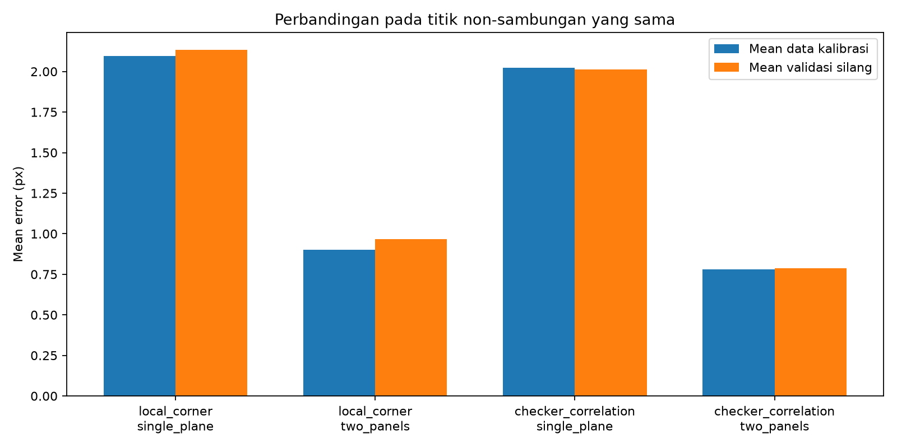

# Metode alternatif untuk papan catur lipat

Dokumen ini menyimpan tahap awal eksperimen dua panel. Riwayat lengkap,
pengaruh tiap perubahan, dan metode lanjutan tersedia pada [laporan perkembangan](evolution.md).

## Hasil utama

Model satu bidang menganggap seluruh papan benar-benar rata. Papan pada dataset mempunyai sambungan lipat. Hipotesis alternatif memperlakukan sisi kiri/kanan sebagai dua bidang planar, dengan matriks K dan distorsi yang sama, tetapi pose terpisah untuk tiap panel pada setiap foto.

Seluruh 29 foto dipertahankan. Titik pada garis sambungan tengah diabaikan secara seragam pada semua varian berdasarkan geometri fisik, tanpa melihat besar residual. Setelah pengecualian ambigu yang sudah terdokumentasi, perbandingan menggunakan **1.216 identitas titik yang sama**.

| Pengukuran sudut | Model papan | Mean kalibrasi (px) | RMS kalibrasi (px) | Mean validasi (px) | RMS validasi (px) |
|---|---|---:|---:|---:|---:|
| local_corner | single_plane | 2.094790 | 2.449132 | 2.135134 | 2.519438 |
| local_corner | two_panels | 0.902377 | 1.276221 | 0.967958 | 1.431743 |
| checker_correlation | single_plane | 2.023705 | 2.338061 | 2.011730 | 2.338795 |
| checker_correlation | two_panels | 0.780340 | 1.048309 | 0.788276 | 1.056129 |



Pengembangan yang paling menjanjikan pada uji ini adalah **korelasi pola empat kuadran + model dua panel**: mean sekitar **0,780 px**, RMS **1,048 px**; mean validasi silang **0,788 px**, RMS validasi **1,056 px**. Ini masih belum memenuhi acuan <0,5 px pada materi.

Angka baseline terdahulu 2,329 px berasal dari 1.418 pengamatan yang juga mencakup titik sambungan. Jangan menganggap perbandingan langsung 2,329 vs 0,780 sebagai efek model saja. Tabel di atas menggunakan kumpulan non-sambungan yang sama; faktor perubahan detektor dan model dapat dilihat terpisah.

## Cara sudut diukur

Metode korelasi mencocokkan pola empat kuadran terang-gelap pada piksel foto, menggunakan normalized correlation. Puncak respons diinterpolasi dengan model kuadratik lokal untuk memperoleh koordinat subpiksel. Homografi hanya menyediakan wilayah pencarian; koordinat hasil deteksi tidak disalin dari proyeksi model kamera.

Kedua detektor memakai konversi BGR ke grayscale yang sama. Pola template berukuran 32 x 32 piksel pada citra perataan dengan skala 100 piksel per kotak. Titik kemudian dikembalikan ke koordinat foto asli. Algoritma diuji pada papan sintetis berperspektif dengan koordinat sudut acuan yang diketahui.

## Model dua panel dan parameter tambahan

Dua panel berbagi satu K dan satu kumpulan koefisien distorsi. Masing-masing panel mendapat pose sendiri pada setiap foto, sehingga ada 58 pose dari **29 foto**, bukan 58 foto. Dibanding satu bidang, model ini memiliki enam parameter pose tambahan per foto. Penurunan error latih saja belum cukup untuk menyatakan model lebih akurat.

Model ini tetap memakai kalibrasi target planar, tetapi merupakan pengembangan atas asumsi satu papan datar pada contoh materi. Dalam laporan tugas, perubahan asumsi tersebut harus dijelaskan dan hasil metode dasar tetap disertakan. Konfigurasi utama proyek tidak diganti otomatis oleh eksperimen ini.

## Pemeriksaan validasi

- Lima bagian validasi silang memisahkan foto training dan foto tertahan. K/distorsi tiap bagian diestimasi tanpa foto yang tertahan.
- Pada foto tertahan, pose diestimasi hanya dari titik jangkar berselang-seling. Jarak reproyeksi dihitung pada titik lain yang tidak digunakan untuk estimasi pose.
- Identitas **579 titik evaluasi** sama pada keempat varian. Foto training/tertahan, indeks jangkar/evaluasi, K/distorsi, dan pose tersimpan di validation_plan.json.
- Mean/RMS kalibrasi dan validasi dihitung ulang secara independen dari parameter tersimpan. Mask antar-panel tidak bertumpang tindih dan setiap titik evaluasi hanya dihitung satu kali.
- Hasil merupakan validasi internal pada dataset yang sama; metode dipilih setelah percobaan. Ini belum merupakan pengukuran akurasi independen, bukan bukti toleransi dimensi mm, dan tidak menetapkan penyebab error tunggal secara pasti.

## Menjalankan

Setelah instalasi awal:

```bash
python initialize.py --skip-install --experiment panels
```

Atau, dengan `.venv` aktif:

```bash
python run.py --experiment panels
```

Laporan baru tersedia di `reports/alternatives.md`. Folder run berisi empat subfolder kandidat, `summary.json`, `comparison.png`, bukti penandaan `correlation_corners`, dan rincian respons `correlation_audit`. Setiap kandidat menyimpan `parameters.npz`, error tiap titik, serta rencana validasi silang yang dapat diperiksa.

`parameters.npz` eksperimen menggunakan `view_photo_indices` dan `view_masks` untuk memasangkan pose dengan panel/foto. Jangan memperlakukan 58 pose sebagai 58 foto atau memasangkan pose eksperimen dengan urutan foto satu bidang.

Eksperimen ini khusus dataset 7x7 dengan orientasi sambungan pada `config/board_panels.json`. Hash foto diverifikasi sebelum metadata diterapkan. Pemetaan tersebut berasal dari tinjauan visual foto asli, bukan dipilih untuk meminimalkan residual.

Referensi metode dasar: [materi Pertemuan 10](../references/Pertemuan_10.pdf), hlm. 45-54 dan 57-60. Implementasi korelasi: [OpenCV matchTemplate](https://docs.opencv.org/4.x/d4/dc6/tutorial_py_template_matching.html).
